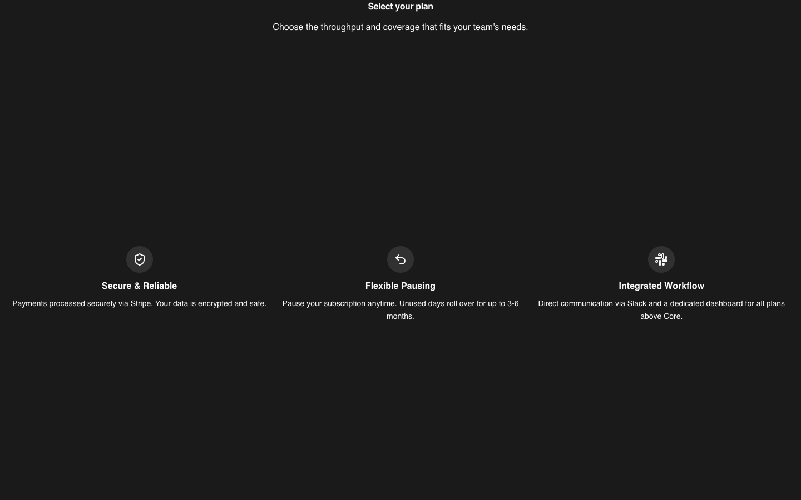

<div align="center">


# Sako

### A design subscription with a GTM touch. The whole company, in one repo.

Landing page · waitlist · client portal · designer studio · GTM app · billing API · 40+ automations · deploy to any cloud

<p>
  
  
  
  
  
</p>

</div>

---

## The story

Sako was a productized design subscription for B2B SaaS teams: one monthly fee, a queue
of design requests, known delivery times, and a GTM engine on top.

- **About $7,000 a month, for 8 months.**
- **10–40% revenue growth.**
- **Built by one person.** No dev team. Every line was written by me with AI agents:
  Cursor, Claude Code, Codex, GLM and friends.

Then we learned that the hard part was not the software. It was distribution, and the design-agency
model did not grow the way we wanted. When the agency side stops working, there is no point in keeping
the software locked up. So we sold the clients (**only the clients, not the code**) and we are giving
the whole stack away, landing page included.

If you want to run a design subscription, a creative agency, or any "unlimited requests for a monthly
fee" business, start here instead of from zero.

> **Not maintained.** This is shared as-is. Expect rough edges. Do your own security review before you
> take real money with it.

## Run everything in one command

```bash
git clone https://github.com/wicolian/sako && cd sako
cp .env.example .env        # add your keys (empty = that feature is off)
docker compose up -d
```

| App | URL | What it is |
|---|---|---|
| Landing | http://localhost:3000 | Marketing site, pricing, ROI calculator, blog, legal |
| API | http://localhost:3001 | Auth, Stripe billing, Slack, email, file storage |
| GTM app | http://localhost:3002 | Campaigns, AI assets, brand kits, website editor |
| Waitlist | http://localhost:3003 | Launch waitlist |
| Wall | http://localhost:3004 | Showcase wall |
| Studio | http://localhost:3100 | Designer queue, SLAs, admin |
| Client portal | http://localhost:5173 | Requests, approvals, billing |
| n8n | http://localhost:5678 | Outbound, PR, recruiting automations |

One Postgres with a database per app, plus Redis. All of it starts with the command above.

## Deploy to any cloud

Same apps, your cloud. Pick a folder in [`terraform/`](terraform/):

| | Database | Apps run on |
|---|---|---|
| [`vercel-neon-railway`](terraform/vercel-neon-railway) | Neon | Vercel + Railway |
| [`aws`](terraform/aws) | RDS Postgres | App Runner + S3 |
| [`gcp`](terraform/gcp) | Cloud SQL | Cloud Run + GCS |
| [`azure`](terraform/azure) | Postgres Flexible Server | Container Apps + Storage |

```bash
cd terraform/aws
cp terraform.tfvars.example terraform.tfvars
terraform init && terraform apply
```

Every push to `main` builds the app images and pushes them to GitHub Container Registry
(`ghcr.io/<you>/sako-*`), which is what the Terraform setups pull.

## What's inside

```
sako/
├── apps/
│   ├── landing/        Next.js + MDX marketing site (yes, you get the landing page too)
│   ├── waitlist/       Vite + React waitlist
│   ├── wall/           Next.js + Prisma showcase wall
│   └── gtm/            Next.js GTM app: campaigns, AI assets, extension
├── platform/
│   ├── apps/client/    Client portal (Vite + React)
│   ├── apps/studio/    Designer studio (Vite + React)
│   └── services/api/   API: Clerk auth, Stripe, Slack, Resend, S3
├── n8n/                44 workflows + sheet templates
├── terraform/          AWS · GCP · Azure · Vercel/Neon/Railway
└── docker-compose.yml  Everything, one command
```

Agent instructions (`CLAUDE.md`, `AGENTS.md`, Cursor rules) are kept in. They are how this was built,
and they will help your agents work on it too.

## Make it yours

- Name, copy and colors: `apps/landing/src/config/`
- Search for `trysako.com` and `example.com`, and put in your own domain and emails.
- Import the n8n workflows in the order in `n8n/docs/PUBLISH_ORDER.md`.

## Screens

<!-- before-and-after:start -->
| Preview (Landing: home) |
|:---:|
|  |

| Preview (Landing: pricing) |
|:---:|
|  |

| Preview (Landing: how it works) |
|:---:|
|  |

| Preview (Landing: services) |
|:---:|
|  |

| Preview (Landing: ROI calculator) |
|:---:|
|  |

| Preview (Landing: compare) |
|:---:|
|  |

| Preview (Landing: enterprise) |
|:---:|
|  |

| Preview (Landing: security) |
|:---:|
|  |

| Preview (Landing: about) |
|:---:|
|  |

| Preview (Landing: blog) |
|:---:|
|  |

| Preview (Landing: book a call) |
|:---:|
|  |

| Preview (Waitlist) |
|:---:|
|  |

| Preview (Wall) |
|:---:|
|  |

| Preview (Client portal: plans) |
|:---:|
|  |

<!-- before-and-after:end -->

The client portal and studio sign-in screens need a real Clerk key to render, so they are not shown.

## Contributing

Pull requests are welcome. Every PR is reviewed by the owner before it is merged, and `main` is
protected. See [CONTRIBUTING.md](CONTRIBUTING.md).

## License

[Sako Source License](LICENSE). In short:

- ✅ Fork it, study it, use it as a reference, change it, and run your own business on it.
- ✅ Open pull requests.
- ❌ Do not sell this code as it is (as a template, boilerplate, or product), in whole or in part.

© 2026 Wicolian. Built solo, with AI agents.
