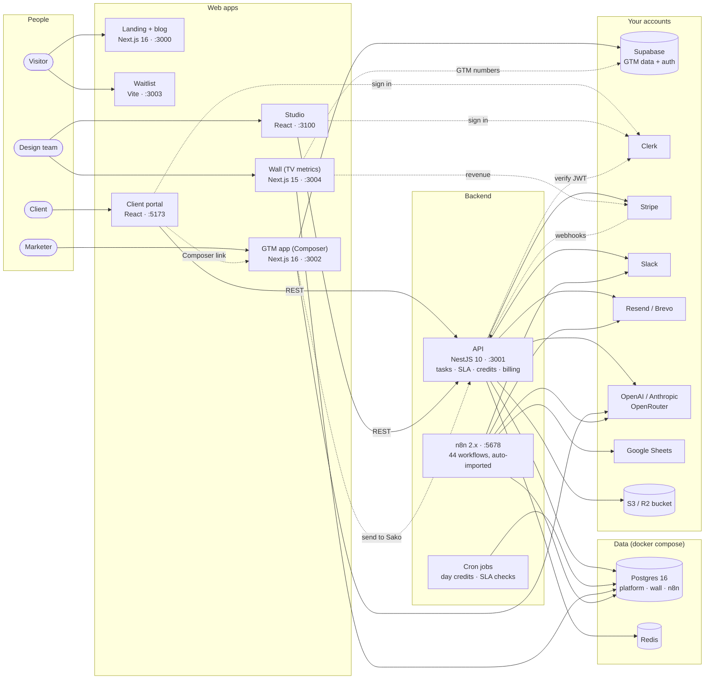
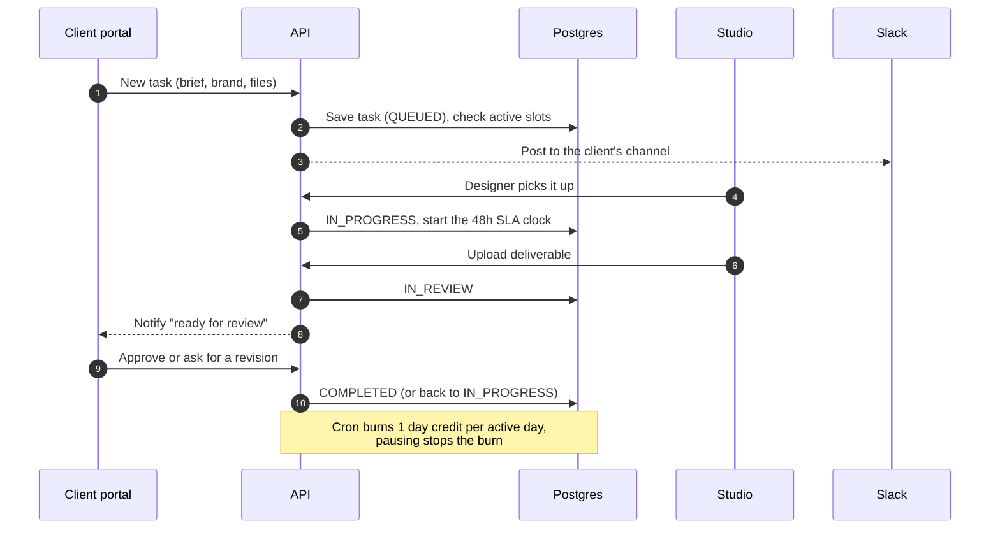
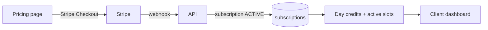
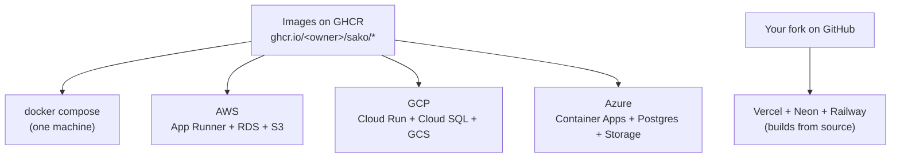

<div align="center">


# Sako

### The open-source operating system for productized agencies.

Run your agency like a product: client portal · request queue · SLA clock · retainer billing · team studio · AI drafts · 44 automations · landing page<br/>
One `docker compose up`. Deploy to AWS, GCP, Azure or Vercel with Terraform.

<p>
  <a href="#run-it-in-one-command"></a>
  <a href="#self-host-with-prebuilt-images"></a>
  <a href="terraform/"></a>
  
  
  
  <a href="LICENSE"></a>
</p>

[Use it for](#use-it-for) · [The story](#the-story) · [Playbooks](docs/playbooks/) · [Product docs](docs/product/) · [What you get](#what-you-get) · [Screens](#screens) · [Architecture](#architecture) · [Run it](#run-it-in-one-command) · [Self-host](#self-host-with-prebuilt-images) · [Deploy](#deploy-to-any-cloud) · [Configuration](#configuration) · [Known issues](#known-issues) · [Support](#support-and-hire-me) · [License](#license)

</div>

---

## Use it for

Sako started as a design subscription. The software is not about design. It runs any agency or service
business that sells monthly retainers instead of one-off projects:

| If you run | Sako gives you |
|---|---|
| **An old-school agency** on email threads, WhatsApp and spreadsheets | One client portal, a request queue with limits on active work, and a clock clients can see |
| **An AI-first service shop** (AI does the first draft, people do the last 20%) | Retainer billing, an SLA per request, AI drafts in the GTM app, and a review flow for the human pass |
| **A video, dev, content or marketing studio** | The same flow: brief → queue → in progress → review → done, with revisions and approvals |
| **A freelancer moving to retainers** | Pricing pages, Stripe subscriptions with pausing and credits, and a landing page to sell it |

What makes it different from a project-management tool: clients pay a monthly fee, see a **queue**, get
work back on a **clock**, and can **pause**. That is how a productized service is sold, and it is all
built in.

## The story

Sako was a **productized design subscription** for B2B SaaS teams. One monthly fee. A queue of design
requests. Known delivery times (48-hour SLA per active slot). A GTM engine on top that turned the design
work into campaigns, outbound and PR.

| | |
|---|---|
| **Revenue** | **$9K MRR at peak** (2 clients at $4,500 a month). About $7K a month over 8 months, with 10–40% growth |
| **Budget** | **$500** in total: domain, Stripe, hosting, first tools |
| **Outbound** | **700+ cold calls** in Q1 2026, 17 email campaigns to 6,000+ people (18–25% opens, 59% peak), 15 demos |
| **Content** | 42 marketing pages and **170+ blog posts** |
| **Delivery** | 48-hour SLA, hit about **85%** of the time |
| **Traffic** | 2,488 visitors to the site (Jan to May 2026), 65% from cold email |
| **The software** | Built by **one person**, with AI agents: Cursor, Claude Code, Codex, GLM and friends. No dev team |
| **What happened** | We sold the clients (**only the clients, not the code**) |

The full case study, with the numbers behind each channel: **[kelashik.com/portfolio/sako-gtm-product-system](https://www.kelashik.com/portfolio/sako-gtm-product-system)**

### Who made it

**Sako = *Sa*njay + *Ko*ushik**, the two founders: Gowri Shankar Muthukumar (Sanjay) and Koushik Venkatesan.

- **Sanjay** (Gowri Shankar Muthukumar) ran the clients and the design: delivery, quality, and a team of **4 designers**.
- **Koushik** ([@wicolian](https://github.com/wicolian)) was the product and GTM person. He built every
  line of this software, and ran **1 HR person and 1 growth hacker**.

### Timeline

| | |
|---|---|
| **End of 2024** | Started. Launch video: [docs/story/launch-video.md](docs/story/launch-video.md) |
| **Jan to Aug 2025** | Building and selling. **No revenue for 9 months** |
| **Sep 2025** | First revenue, then about $7k a month with 10–40% growth |
| **~Apr 2026** | Sold the clients, closed |
| **Oct 2026** | Open-sourced: software, automations and [playbooks](docs/playbooks/) |

The software took almost 3 months to build, with no funding and no backup.

Then we learned that the hard part was not the software. It was distribution, and the design-agency model
did not grow the way we wanted. When the agency side stops working, there is no point in keeping the
software locked up. So the whole stack is here, **landing page included**.

If you want to run a design subscription, a creative agency, a productized service, or any
"unlimited requests for a monthly fee" business, start here instead of from zero.

> [!NOTE]
> **Free for small teams, paid for bigger ones.** If your company makes under **$100K a year**, Sako is
> free to use and run your business on. Above that, you need a [commercial license](#commercial-license).
> It is maintained by the author. Some parts still have gaps, see [Known issues](#known-issues).

## What you get

| App | Folder | Port | What it does | Status |
|---|---|---|---|---|
| **Landing** | `apps/landing` | 3000 | Marketing site: home, pricing, how it works, services, ROI calculator, compare, enterprise, security, blog (MDX), legal pages, Cal.com booking | ✅ Works |
| **API** | `platform/services/api` | 3001 | NestJS API: Clerk auth, workspaces, tasks, SLAs, day credits, Stripe billing, Slack, email (Resend), S3 storage, AI drafts, cron jobs | ✅ Works |
| **Client portal** | `platform/apps/client` | 5173 | Where customers live: dashboard, plan and credits, tasks, review and approvals, calendar, brands, settings, billing | ✅ Works |
| **Studio** | `platform/apps/studio` | 3100 | Where the design team lives: operator overview, all tasks, task workspace, calendar, clients, billing inspector, user admin | ✅ Works |
| **Waitlist** | `apps/waitlist` | 3003 | Launch waitlist with countdown | ✅ Works |
| **Wall** | `apps/wall` | 3004 | Live business metrics for a TV screen: Stripe, PostHog, GA4, investor mode | ✅ Works |
| **n8n** | `n8n` | 5678 | 44 workflows: leads, content, PR, analytics, recruiting, infra | ✅ Works (workflows auto-imported; add your credentials) |
| **GTM app (Composer)** | `apps/gtm` | 3002 | AI GTM workspace: agent, campaigns, brand DNA, claims and evidence, competitors, newsletters, landing-page playground, AI marketing team, integrations | ✅ Works (needs Supabase, opt-in) |

<details>
<summary><b>The n8n workflows (44)</b></summary>

| Folder | Count | What they do |
|---|---|---|
| `leads/` | 14 | Lead lists, enrichment, scoring, outbound email, warm opens, call logging |
| `content/` | 8 | Content backlog, monitoring, drafting, publishing with Slack approval |
| `pr/` | 8 | Journalist monitoring, earned media outreach, media kit generator |
| `_shared/` | 5 | Error handler and shared sub-workflows |
| `analytics/` | 3 | Workflow metrics and reporting |
| `infra/` | 3 | Health checks and housekeeping |
| `recruiting/` | 3 | Designer outreach and candidate pipeline |

Sheet templates for every workflow are in `n8n/templates/`. All 44 are imported on first start. Activate them in the order in `n8n/docs/PUBLISH_ORDER.md`.

</details>

## Screens

All screens are from this repo, running locally with `docker compose up`, signed in as a demo user with
demo data.

### Client portal

<table>
<tr><td width="50%" valign="top"><br><sub><b>Dashboard: plan, credits, work in flight</b></sub></td><td width="50%" valign="top"><br><sub><b>Tasks</b></sub></td></tr>
<tr><td width="50%" valign="top"><br><sub><b>Task detail and review</b></sub></td><td width="50%" valign="top"><br><sub><b>New request</b></sub></td></tr>
<tr><td width="50%" valign="top"><br><sub><b>Calendar</b></sub></td><td width="50%" valign="top"><br><sub><b>Brands</b></sub></td></tr>
<tr><td width="50%" valign="top"><br><sub><b>Settings</b></sub></td><td width="50%" valign="top"><br><sub><b>Sign up</b></sub></td></tr>
</table>

### Studio (the design team's side)

<table>
<tr><td width="50%" valign="top"><br><sub><b>Operator overview</b></sub></td><td width="50%" valign="top"><br><sub><b>All studio tasks</b></sub></td></tr>
<tr><td width="50%" valign="top"><br><sub><b>Task workspace</b></sub></td><td width="50%" valign="top"><br><sub><b>Studio calendar</b></sub></td></tr>
<tr><td width="50%" valign="top"><br><sub><b>Clients</b></sub></td><td width="50%" valign="top"><br><sub><b>Billing inspector</b></sub></td></tr>
<tr><td width="50%" valign="top"><br><sub><b>User management</b></sub></td><td width="50%" valign="top"><br><sub><b>Settings</b></sub></td></tr>
</table>

### GTM app (Composer)

<table>
<tr><td width="50%" valign="top"><br><sub><b>Dashboard</b></sub></td><td width="50%" valign="top"><br><sub><b>GTM agent</b></sub></td></tr>
<tr><td width="50%" valign="top"><br><sub><b>Campaigns</b></sub></td><td width="50%" valign="top"><br><sub><b>Landing-page playground</b></sub></td></tr>
<tr><td width="50%" valign="top"><br><sub><b>AI marketing team</b></sub></td><td width="50%" valign="top"><br><sub><b>Brand DNA</b></sub></td></tr>
<tr><td width="50%" valign="top"><br><sub><b>Claims review</b></sub></td><td width="50%" valign="top"><br><sub><b>Competitor intelligence</b></sub></td></tr>
<tr><td width="50%" valign="top"><br><sub><b>IQ</b></sub></td><td width="50%" valign="top"><br><sub><b>Newsletter generator</b></sub></td></tr>
<tr><td width="50%" valign="top"><br><sub><b>Automation playbooks</b></sub></td><td width="50%" valign="top"><br><sub><b>Integrations</b></sub></td></tr>
<tr><td width="50%" valign="top"><br><sub><b>Analytics</b></sub></td><td width="50%" valign="top"><br><sub><b>Onboarding</b></sub></td></tr>
<tr><td width="50%" valign="top"><br><sub><b>Settings</b></sub></td></tr>
</table>

### Landing page

<table>
<tr><td width="50%" valign="top"><br><sub><b>Pricing</b></sub></td><td width="50%" valign="top"><br><sub><b>How it works</b></sub></td></tr>
<tr><td width="50%" valign="top"><br><sub><b>Services</b></sub></td><td width="50%" valign="top"><br><sub><b>ROI calculator</b></sub></td></tr>
<tr><td width="50%" valign="top"><br><sub><b>Compare</b></sub></td><td width="50%" valign="top"><br><sub><b>Enterprise</b></sub></td></tr>
<tr><td width="50%" valign="top"><br><sub><b>Security</b></sub></td><td width="50%" valign="top"><br><sub><b>About</b></sub></td></tr>
<tr><td width="50%" valign="top"><br><sub><b>Blog</b></sub></td><td width="50%" valign="top"><br><sub><b>Book a call</b></sub></td></tr>
</table>

### Waitlist and wall

<table>
<tr><td width="50%" valign="top"><br><sub><b>Waitlist</b></sub></td><td width="50%" valign="top"><br><sub><b>Wall: live metrics from the platform database</b></sub></td></tr>
</table>

<details>
<summary><b>Every screen, full size</b></summary>

<!-- before-and-after:start -->
| Preview (Landing: home) |
|:---:|
|  |

| Preview (Landing: pricing) |
|:---:|
|  |

| Preview (Landing: how it works) |
|:---:|
|  |

| Preview (Landing: services) |
|:---:|
|  |

| Preview (Landing: roi calculator) |
|:---:|
|  |

| Preview (Landing: compare) |
|:---:|
|  |

| Preview (Landing: enterprise) |
|:---:|
|  |

| Preview (Landing: security) |
|:---:|
|  |

| Preview (Landing: about) |
|:---:|
|  |

| Preview (Landing: blog) |
|:---:|
|  |

| Preview (Landing: book a call) |
|:---:|
|  |

| Preview (Client: dashboard) |
|:---:|
|  |

| Preview (Client: tasks) |
|:---:|
|  |

| Preview (Client: task detail) |
|:---:|
|  |

| Preview (Client: new task) |
|:---:|
|  |

| Preview (Client: calendar) |
|:---:|
|  |

| Preview (Client: brands) |
|:---:|
|  |

| Preview (Client: settings) |
|:---:|
|  |

| Preview (Client: sign up) |
|:---:|
|  |

| Preview (Studio: dashboard) |
|:---:|
|  |

| Preview (Studio: tasks) |
|:---:|
|  |

| Preview (Studio: tasks t2) |
|:---:|
|  |

| Preview (Studio: calendar) |
|:---:|
|  |

| Preview (Studio: clients) |
|:---:|
|  |

| Preview (Studio: billing) |
|:---:|
|  |

| Preview (Studio: admin users) |
|:---:|
|  |

| Preview (Studio: settings) |
|:---:|
|  |

| Preview (Studio: sign in) |
|:---:|
|  |

| Preview (GTM: dashboard) |
|:---:|
|  |

| Preview (GTM: agent) |
|:---:|
|  |

| Preview (GTM: campaigns) |
|:---:|
|  |

| Preview (GTM: playground) |
|:---:|
|  |

| Preview (GTM: team) |
|:---:|
|  |

| Preview (GTM: brand dna) |
|:---:|
|  |

| Preview (GTM: claims) |
|:---:|
|  |

| Preview (GTM: competitors) |
|:---:|
|  |

| Preview (GTM: iq) |
|:---:|
|  |

| Preview (GTM: newsletters) |
|:---:|
|  |

| Preview (GTM: automation) |
|:---:|
|  |

| Preview (GTM: integrations) |
|:---:|
|  |

| Preview (GTM: analytics) |
|:---:|
|  |

| Preview (GTM: onboarding) |
|:---:|
|  |

| Preview (GTM: settings) |
|:---:|
|  |

| Preview (Waitlist) |
|:---:|
|  |

| Preview (Wall) |
|:---:|
|  |

<!-- before-and-after:end -->

</details>

## Architecture



### How a design request moves



### Billing in one picture



### Deploy targets



## Run it in one command

You need Docker (Docker Desktop, OrbStack or Colima all work).

```bash
git clone https://github.com/wicolian/sako && cd sako
cp .env.example .env          # add your keys. Empty = that feature is off.
docker compose up -d --build  # first build takes a few minutes
```

Open http://localhost:3000. All URLs:

| | URL |
|---|---|
| Landing | http://localhost:3000 |
| API | http://localhost:3001 |
| Waitlist | http://localhost:3003 |
| Wall | http://localhost:3004 |
| Studio | http://localhost:3100 |
| Client portal | http://localhost:5173 |
| n8n | http://localhost:5678 |
| GTM app (opt-in, needs Supabase) | `docker compose --profile gtm up -d --build` → http://localhost:3002 |

**Keys the API needs to start:** a free [Clerk](https://clerk.com) development instance
(`CLERK_SECRET_KEY`, `VITE_CLERK_PUBLISHABLE_KEY`) and [Stripe](https://stripe.com) test keys
(`STRIPE_SECRET_KEY`, `STRIPE_WEBHOOK_SECRET`). Set `ALLOWED_STUDIO_DOMAINS` to your team's email domain.

**Demo data:** sign up once in the client portal, then
`docker compose exec -T postgres psql -U sako -d platform < docker/seed-demo.sql`.
You get a workspace on an active plan, a brand and 5 tasks, and you can open the studio.

**n8n:** the 44 workflows are imported on first start. Add your credentials in n8n, then activate them.


## Self-host with prebuilt images

Every push to `main` builds all images and pushes them to GitHub Container Registry. Self-hosters do not
need to build anything:

```bash
curl -fsSL https://raw.githubusercontent.com/wicolian/sako/main/selfhost/install.sh | sh
```

The script downloads `docker-compose.yml`, makes a `.env` with random database and n8n secrets, pulls the
images and starts everything. Pin a version with `SAKO_VERSION=v1.0.0`. Use your own fork's images with
`SAKO_IMAGE_OWNER=<your-github-user>`.

> [!NOTE]
> The client and studio are static builds, so Clerk's publishable key is baked in at build time. With the
> prebuilt images, rebuild those two with your key: `docker compose build client studio`.

## Deploy to any cloud

Pick one folder in [`terraform/`](terraform/). Each one makes a Postgres, a file bucket and one service per app.

| Folder | Database | Apps run on | Best for |
|---|---|---|---|
| [`vercel-neon-railway`](terraform/vercel-neon-railway) | Neon | Vercel (web) + Railway (API, n8n) | Fastest start, cheapest |
| [`aws`](terraform/aws) | RDS Postgres 16 | App Runner + S3 | AWS shops |
| [`gcp`](terraform/gcp) | Cloud SQL Postgres 16 | Cloud Run + GCS | Google Cloud |
| [`azure`](terraform/azure) | Postgres Flexible Server | Container Apps + Storage | Azure |

```bash
cd terraform/gcp
cp terraform.tfvars.example terraform.tfvars   # tokens, keys, image names
terraform init
terraform apply
```

All four pass `terraform validate` in CI. They are starting points, not hardened setups: the databases
accept connections from the internet with a password. Lock them down before real customers use them.
More in [`terraform/README.md`](terraform/README.md).

## Configuration

One `.env` at the root feeds every app (`.env.example` lists all ~190 keys, grouped by app). The ones
that matter most:

| Key | Used by | What for |
|---|---|---|
| `POSTGRES_PASSWORD` | all | Database password (the installer makes a random one) |
| `CLERK_SECRET_KEY`, `VITE_CLERK_PUBLISHABLE_KEY` | API, client, studio | Sign-in |
| `ALLOWED_STUDIO_DOMAINS` | API, studio | Email domains allowed into the studio, e.g. `yourcompany.com` |
| `STRIPE_SECRET_KEY`, `STRIPE_WEBHOOK_SECRET`, `STRIPE_PUBLISHABLE_KEY` | API, client | Subscriptions and checkout |
| `RESEND_API_KEY`, `EMAIL_FROM` | API | Transactional and marketing email |
| `SLACK_CLIENT_ID`, `SLACK_CLIENT_SECRET`, `SLACK_SIGNING_SECRET`, `SLACK_BOT_TOKEN` | API, n8n | Per-client Slack channels and approvals |
| `OPENAI_API_KEY`, `ANTHROPIC_API_KEY` | API, GTM, n8n | AI drafts, estimates, content |
| `STORAGE_*` | API | S3-compatible bucket for uploads (Cloudflare R2 works) |
| `N8N_ENCRYPTION_KEY` | n8n | Encrypts stored credentials |
| `SAKO_IMAGE_OWNER`, `SAKO_VERSION` | compose | Which prebuilt images to pull |

## Project layout

```
sako/
├── apps/
│   ├── landing/          Next.js 16 + MDX marketing site
│   │   ├── content/      Every page and blog post as MDX
│   │   └── src/config/   Brand, links, nav, pricing: change these first
│   ├── waitlist/         Vite + React waitlist (+ a Vercel function)
│   ├── wall/             Next.js live metrics dashboard (TV kiosk)
│   └── gtm/              Next.js GTM app, Postgres migrations, browser extension
├── platform/
│   ├── apps/client/      Client portal (React 18 + Vite + Clerk)
│   ├── apps/studio/      Studio (React 18 + Vite + Clerk)
│   ├── packages/         Shared review UI
│   └── services/api/     NestJS 10 + Prisma 5: auth, tasks, billing, Slack, AI, cron
├── n8n/
│   ├── workflows/        44 workflow JSON files, by area
│   └── templates/        Google Sheets templates the workflows read and write
├── terraform/            aws · gcp · azure · vercel-neon-railway
├── selfhost/install.sh   One-line installer for prebuilt images
├── docker/               Postgres init (one database per app)
├── docs/screens/         The screenshots above
├── .github/workflows/    CI and image publishing
└── docker-compose.yml    Everything, one command
```

Agent instructions (`CLAUDE.md`, `AGENTS.md`, Cursor and agent rules) are kept in on purpose. They are how
this was built, and they help your agents work on it too.

## Develop one app at a time

```bash
# API + client + studio (npm workspaces)
cd platform && npm install && npm run dev

# Landing (pnpm 8)
cd apps/landing && pnpm install && pnpm dev

# GTM app (bun)
cd apps/gtm && bun install && bun dev
```

## Make it yours

1. **Brand:** name, colors, nav and pricing live in `apps/landing/src/config/`. Logos in `public/` of each app.
2. **Domains and emails:** search for `trysako.com` and `example.com` and put in your own.
3. **Plans:** plan codes and limits are in the API (`platform/services/api/src/subscription`) and the `plans` table.
4. **Booking link:** set your Cal.com handle in `apps/landing/src/components/blocks/CalEmbed.tsx`.
5. **Automations:** import the n8n workflows in the order in `n8n/docs/PUBLISH_ORDER.md`, then add your credentials in n8n.

## CI/CD

| Workflow | When | What |
|---|---|---|
| `ci.yml` | Every PR and push | Secret scan (gitleaks), `terraform fmt` + `validate` for all 4 clouds, `docker compose config` |
| `images.yml` | Push to `main`, or a `v*` tag | Builds 8 images, pushes `ghcr.io/<owner>/sako/*:latest` (and `:v1.0.0` for tag `v1.0.0`) |
| Dependabot | Weekly | Opens PRs for security and version updates (npm, Docker, Actions) |

## Known issues

All tracked as [GitHub issues](https://github.com/wicolian/sako/issues). The ones a new user will hit:

- **GTM needs Supabase**, not the shared Postgres. Some GTM pages give 404 or say "No workspace found" (#17).
- **GTM "Send to Sako" is unfinished** (#20).
- **Client pricing page shows no plans** until you add your own Stripe pricing table (#7). Use the demo data script meanwhile.
- **Client and studio bake the Clerk key in at build time**, so rebuild them with your key (#10).
- **Studio AI page is empty, Pods page is a placeholder** (#8, #9).
- **Billing rules to decide:** day credits burn daily even with no open task (#22); the SLA clock after a revision (#21).
- **Terraform is validated, not applied** on real accounts (#12).

What the original specs planned versus what the code does: [docs/product](docs/product/). Fixes are welcome, see
[CONTRIBUTING.md](CONTRIBUTING.md).

## Support and hire me

If Sako saved you months of work, you can say thanks:

- ⭐ **Star the repo.** It helps other founders find it.
- 💚 **Sponsor me** on [GitHub Sponsors](https://github.com/sponsors/wicolian) (the ♥ Sponsor button at the top of the repo).
- 🤝 **Hire me:** I do paid **forward-deployed engineering (FDE)** and freelance sessions: I set up Sako
  (or something like it) for your business, or build your product and GTM stack with AI agents.

Get in touch: **[kelashik.com](https://kelashik.com)** · **[LinkedIn](https://www.linkedin.com/in/kelashik)**

## Contributing

Pull requests are welcome. `main` is protected, and every PR is reviewed by the owner before it is merged.
Read [CONTRIBUTING.md](CONTRIBUTING.md) first. Security problems: see [SECURITY.md](SECURITY.md).

## License

[Sako License 1.1](LICENSE). In short:

| You are | You can |
|---|---|
| A company making **under $100K a year** | ✅ Use it, change it, run your business on it. Free |
| An individual, student, non-profit or school | ✅ Free |
| Anyone trying it out | ✅ Free for 30 days |
| A company the author works for | ✅ Free, any size (see section 3a of the license) |
| A company making **$100K a year or more** | 💼 Needs a [commercial license](#commercial-license) |
| Anyone | ❌ Do not sell this code as it is (as a template, boilerplate or hosted product) |

Version 1.0.0 stays under the [Sako Source License 1.0](https://github.com/wicolian/sako/blob/v1.0.0/LICENSE).
This is a source-available license, not an OSI open-source license.

## Commercial license

For agencies and studios making **$100K a year or more**. You get:

- The right to run Sako in your business, for one company and its own brands
- Updates and security fixes for the length of the license
- Priority help with issues
- Optional paid setup: I deploy it on your cloud, connect your Stripe, Clerk and Slack, and import your workflows

| Plan | For | Price |
|---|---|---|
| **Free** | Under $100K revenue, individuals, non-profits, schools | $0 |
| **Agency** | $100K to $1M revenue | **$1,500 / year** or $149 / month |
| **Studio** | Over $1M revenue | **$4,500 / year**, includes priority help |
| **Setup** (optional) | Anyone | **From $1,500** one-time: deployed on your cloud, Stripe, Clerk and Slack connected, workflows imported |

**Get one:** [contact@kelashik.com](mailto:contact@kelashik.com) · [kelashik.com](https://kelashik.com)

---

<div align="center">

**Built solo, with AI agents.** © 2026 Koushik Venkatesan ([@wicolian](https://github.com/wicolian)) · [kelashik.com](https://kelashik.com) · [LinkedIn](https://www.linkedin.com/in/kelashik)

</div>
